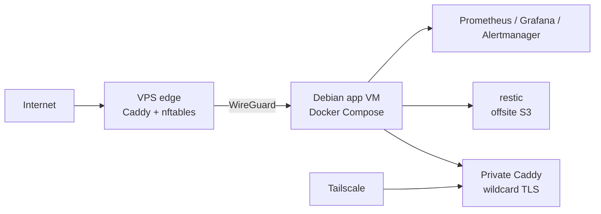

# homelab

A friends & family platform: one hypervisor, one application VM, one edge VPS, all defined in git.

[](https://github.com/cooldog14/homelab-friendsandfamily/actions/workflows/ci.yml)

The platform serves photos, documents, media, chat and games to a small group of
people. A single Proxmox hypervisor runs one Debian VM that hosts ~45 Docker
Compose services across 8 stacks; a small Debian VPS is the only
internet-facing host and reaches the VM over WireGuard. Everything that can be
codified — playbooks, compose files, Caddy routes, firewall rules, VM
definition — lives in this repository.



## Numbers

| Metric | Value |
|---|---|
| Compose services | 45 |
| Compose stacks | 8 |
| Public HTTPS vhosts | 13 |
| Private (tailnet) vhosts | 17 |
| Restore point objective | 24 h |
| Restore time objective | 15 s |
| Hosts | 1 hypervisor, 1 application VM, 1 edge VPS |

RTO measured 2026-11-09 with `make restore-test`: 18 objects / 56.5 MiB
restored from the offsite restic repository.

## What this demonstrates

- **A public edge for a host that has no public IP.** TLS terminates on the VPS;
  the home address never appears in public DNS. The application host accepts no
  inbound connection from the internet.
- **Segmentation with two different tools for two different jobs.** WireGuard
  carries public backend traffic from the edge to the app VM. Tailscale is the
  only human admin path. Neither tunnel can reach the other's surfaces.
- **Tested restores, not just backups.** A drill pulls real objects out of the
  offsite repository, validates the database dumps, and fails on corruption.
- **Incident handling with written post-mortems.** Outages end with a dated
  runbook entry that records the symptom, the diagnosis, the repair and the
  prevention.
- **SRE-grade observability and IaC.** Prometheus with Alertmanager routing and
  blackbox probes on the public edge, plus Ansible and OpenTofu for host and VM
  state.

## Deep dives

- [A public edge for a host that has no public IP](docs/case-studies/01-public-edge.md)
  — three-layer design, the reload trap, and the ARP blackhole.
- [The restore drill](docs/case-studies/02-restore-drill.md)
  — what restic covers, why databases are dumped first, and what the drill
  actually asserts.
- [The observability blind spot](docs/case-studies/03-observability-blind-spot.md)
  — seven days of silence, the firewall rule behind it, and the alert rules
  that came after.

## Operations

This is a best-effort personal platform, not a highly available service. There
is one hypervisor, one application VM and one VPS; each is a single point of
failure, and maintenance windows are announced rather than avoided.

Install the Ansible collections once per workstation first, then use the Make
targets:

```sh
ansible-galaxy collection install -r ansible/requirements.yml
```

| Command | What it does |
|---|---|
| `make check` | Validates compose files, both Caddy configs, the public/private host list, shell scripts, and the observability rules. This is what CI runs. |
| `make host` | Applies `ansible/chill.yml` to the application VM (idempotent; a second run reports `changed=0`). |
| `make vps` | Applies `ansible/vps.yml` to the edge VPS: Caddy sites, nftables forwarding, WireGuard. |
| `make deploy` | Ships the `stacks/` tree to the VM and restarts affected containers. |
| `make edge-reload` | Restarts the private Caddy after a route edit; `docker compose up -d` is a no-op when the compose file did not change. |
| `make restore-test` | Restores a curated set from the offsite restic repository and asserts dump/config integrity. |
| `make tofu-check` | Offline OpenTofu format and validation checks (no credentials needed). |
| `make tofu-plan` | Read-only plan of the application VM against the hypervisor. |
| `make ansible-check` | Syntax-checks both playbooks. |

## Security model

- The public edge accepts **key-only SSH**; password authentication and root
  password login are disabled.
- **Admin access is tailnet-only.** Private services and the host admin
  interface are reachable from Tailscale, never from the public edge.
- **No secrets in git.** Environment files and keys live on the hosts with
  restrictive permissions; CI runs a secret scanner over the full history.
- **Least privilege for automation.** OpenTofu uses a dedicated Proxmox API
  token scoped to auditing, the single VM and its storage, with credentials
  stored outside the repository.
- **WireGuard is VPS-to-VM only.** It carries published backends, is scoped to
  their ports, and is never an admin path.
- **Isolation is layered.** UFW, nftables and explicit `DOCKER-USER` rules keep
  containers from reaching each other or the host outside their documented
  paths.

## Stack

Debian, Proxmox VE, Docker Compose, Caddy, WireGuard, Tailscale, restic,
systemd, Ansible, OpenTofu, Prometheus, Grafana, Alertmanager.
