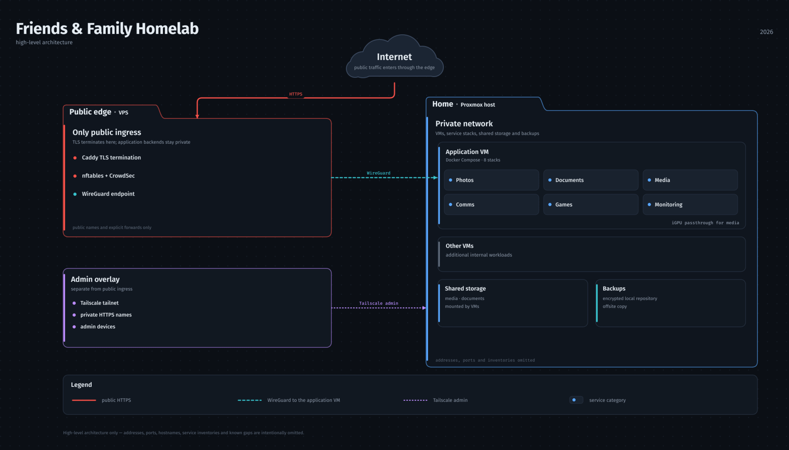

# homelab

A friends & family platform: one application VM and one edge VPS, managed in
git, on one Proxmox hypervisor.

[](https://github.com/cooldog14/homelab-friendsandfamily/actions/workflows/ci.yml)

The platform serves photos, documents, media, chat and games to a small group of
people. `chill-01` hosts 42 Docker Compose services across 8 stacks; a small
Debian VPS is the only host with a public IP and reaches the application VM over
WireGuard.

Playbooks, Compose files, Caddy routes, NAT rules and an import-only definition
of `chill-01` live here. Secrets and application data do not. The VPS input
firewall, CrowdSec setup and Caddy package source are not yet fully codified.



The diagram is generated from [`docs/diagram/inventory.yaml`](docs/diagram/inventory.yaml);
render instructions are in [`docs/diagram`](docs/diagram).

## Numbers

| Metric | Value |
|---|---|
| Compose services | 42 |
| Compose stacks | 8 |
| Public HTTPS vhosts | 13 |
| Private (tailnet) vhosts | 16 |
| Restore point objective | 24 h |
| Full-platform recovery time | Not measured |
| Managed machines | 1 application VM, 1 edge VPS |

The 2026-11-09 `make restore-test` drill took 15 seconds to restore and validate
18 objects / 56.5 MiB from the offsite restic repository. That is a sampled
artifact-restore time, **not** an RTO for rebuilding the platform.

## What this demonstrates

- **A public edge for a host that has no public IP.** TLS terminates on the VPS;
  the home address never appears in public DNS. Internet-originated connections
  reach the application VM only through VPS proxying or explicit port forwarding.
- **Different tunnels for backend and admin access.** WireGuard carries edge
  traffic and the P2P exit; Tailscale is the primary human admin path. The
  exceptions and remaining exposure are listed under **Current gaps**.
- **Sampled restores, not just backups.** A drill pulls real objects out of the
  offsite repository, validates the two PostgreSQL and two SQLite dumps, and
  fails on sampled corruption. It does not rebuild or restore the full platform.
- **Incident handling with written post-mortems.** Outages end with a dated
  runbook entry that records the symptom, the diagnosis, the repair and the
  prevention.
- **Observable, reproducible core services.** Prometheus, Alertmanager and
  blackbox probes cover the application VM and public edge. Ansible manages host
  state; OpenTofu plans the imported application VM without applying changes.

## Deep dives

- [A public edge for a host that has no public IP](docs/case-studies/01-public-edge.md)
  — three-layer design, the reload trap, and the ARP blackhole.
- [The restore drill](docs/case-studies/02-restore-drill.md)
  — what restic covers, why databases are dumped first, and what the drill
  actually asserts.
- [The observability blind spot](docs/case-studies/03-observability-blind-spot.md)
  — seven days of silence, the firewall rule behind it, and the alert rules
  that came after.

## Operations

This is a best-effort personal platform, not a highly available service. The
managed platform has one hypervisor, one application VM and one VPS; each is a
single point of failure, and maintenance windows are announced rather than
avoided.

Install the Ansible collections once per workstation first, then use the Make
targets:

```sh
ansible-galaxy collection install -r ansible/requirements.yml
```

| Command | What it does |
|---|---|
| `make check` | Validates compose files, both Caddy configs, the public/private host list, shell scripts, and the observability rules. This is what CI runs. |
| `make host` | Applies `ansible/chill.yml` to the application VM (idempotent; a second run reports `changed=0`). |
| `make vps` | Applies `ansible/vps.yml` to the edge VPS: Caddy sites, nftables forwarding, WireGuard. |
| `make deploy` | Ships the `stacks/` tree to the VM and restarts affected containers. |
| `make edge-reload` | Restarts the private Caddy after a route edit; `docker compose up -d` is a no-op when the compose file did not change. |
| `make restore-test` | Restores a curated set from the offsite restic repository and asserts dump/config integrity. |
| `make tofu-check` | Offline OpenTofu format and validation checks (no credentials needed). |
| `make tofu-plan` | Read-only plan of the application VM against the hypervisor. |
| `make ansible-check` | Syntax-checks both playbooks. |

## Current gaps

A live review on 2026-11-09 found these differences between the intended design
and the enforced state. Their remediation is the immediate list in [TODO.md](TODO.md).

- The `DOCKER-USER` isolation rules are not restored at boot. A broad `wg0` UFW
  allow and broad VPS forwarding rules expose more of the application subnet
  than the published-backend model implies; several admin UIs are reachable
  from the VPS.
- A PostgreSQL dump failure aborts the whole backup; only Kavita and Gotify
  SQLite databases are dumped consistently. Other application databases and
  Minecraft state are copied while running.
- Monitoring runs in the failure domain it watches: there is no external
  dead-man alert, hypervisor exporter or PVE notification target. The 2026-11-09
  review also observed cAdvisor OOM kills and Grafana nearing its memory limit.
- `make deploy` ships the working tree without requiring a clean commit or
  recording the deployed revision; it is not yet a provenance guarantee.

## Security model

- The public edge accepts **key-only SSH**; password authentication and root
  password login are disabled.
- **Tailscale is the primary admin path.** VPS public-key SSH and `chill-01` LAN
  SSH are separate admin paths. WireGuard is not a human admin path by policy,
  although admin-port exposure from the VPS remains a current gap.
- **Secrets are excluded from git.** Environment files and keys live on hosts
  with restrictive permissions; CI runs Gitleaks over full history.
- **OpenTofu is plan-only by workflow.** Credentials are stored outside the
  repository.
- **WireGuard has separate backend and P2P uses.** `chill0` links the VPS to the
  application VM; `wg0` provides P2P egress through the VPS. Their intended
  port-level restrictions are not yet fully enforced.
- **Isolation uses UFW, nftables and `DOCKER-USER`.** The container rules are
  effective only after `host/firewall-neko.sh` runs; boot persistence is open.

## Stack

Debian, Proxmox VE, Docker Compose, Caddy, WireGuard, Tailscale, restic,
systemd, Ansible, OpenTofu, Prometheus, Grafana, Alertmanager.
