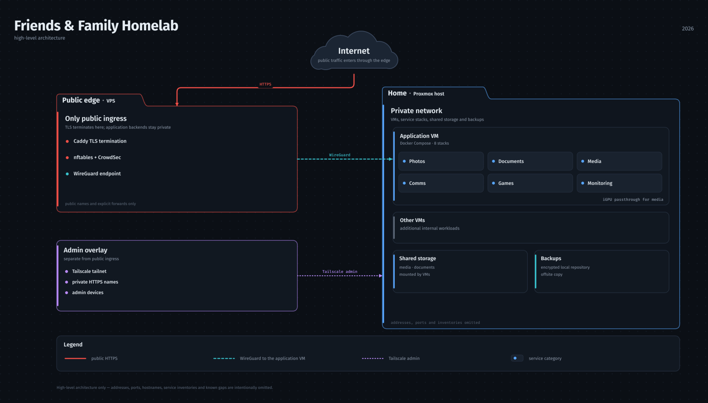

# Architecture

Ansible sets up the hosts. Docker Compose defines the apps. OpenTofu tracks
the application VM but does not apply changes. Secrets and application data
stay outside Git.

Prometheus detects failures and notifications go to Gotify. A separate check
runs outside the lab and can signal when the local alert path is down.

There is no automatic failover. Recovery is manual. App backups keep a local
copy and an offsite copy.

[Diagram source and credits](diagram/README.md)
