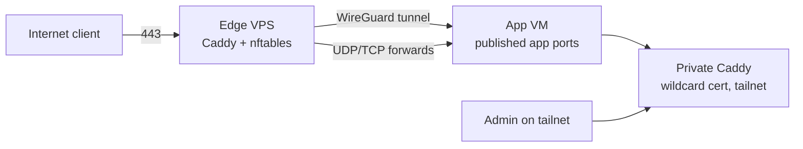

# Case study: a public edge for a host that has no public IP

## Problem

The application host is a VM on a home hypervisor. It has a private LAN address,
a WireGuard address on a tunnel, and a tailnet address — and no public address.
The ISP router cannot be trusted to forward ports, the residential address
changes, and the machine is the only application host, so "publish it directly"
is not an option.

Constraints:

- Public HTTPS for friends and family, with real certificates.
- No inbound port on the home router.
- Admin traffic must never share the public path with anonymous visitors.
- One host is enough: no Kubernetes, no service mesh, no second control plane.

## Design

A small VPS is the only internet-facing box. It runs Caddy and nftables and
nothing else, and it reaches the application host over a static WireGuard
tunnel.

Three layers, each with one job:

1. **Public TLS terminates on the VPS.** Caddy owns the public names, gets
   certificates over ACME (HTTP-01/DNS-01 as available), and proxies to the
   tunnel address. The home IP is never in public DNS.
2. **The tunnel carries backends only.** The WireGuard link is static, key-only,
   and scoped to the published app ports. It is not an admin path.
3. **Admin lives on the tailnet.** A second Caddy on the application host serves
   `*.h.example.com` from a wildcard DNS-01 certificate, listening only on the
   tunnel address and the tailnet interface. Exact-host matchers decide which
   port each private name reaches.

The split matters: public vhosts are declared on the VPS, private vhosts on the
application host. Two Caddies never race for the same name, which would mean two
ACME orders and a rate-limited afternoon.

### Non-HTTP traffic

Some services are not HTTP: a voice server (TCP+UDP), a browser sandbox over
WebRTC (UDP port range), a TURN server, a game server. Those get explicit
nftables DNAT rules on the VPS, forwarded to the tunnel address, with the same
"only what is published" discipline as the HTTP vhosts.

### Why not a tunnel-everything mesh?

A mesh VPN that publishes services would also publish the admin surfaces unless
each one is fenced again. The VPS edge keeps the public and private sets
physically distinct: an anonymous visitor can only reach names that exist in the
public Caddy sites directory.

## Failure modes seen in practice

| Symptom | Cause | First check |
|---|---|---|
| Every public vhost 502s at once | WireGuard handshake stale or route missing | `wg show` handshake age, then `ping` the tunnel address |
| One vhost 502s, others fine | Backend port wrong, or the app binds only on the LAN address | `curl` the backend from the VPS over the tunnel |
| Public vhost hangs, LAN fine | Stale ARP entry on the router for the app host | `tcpdump -e` on the app NIC: replies to a foreign MAC |
| 404 "unknown private service" | Host not matched by an exact matcher, fell through to the default | the private Caddyfile matcher list |
| Caddy reload did nothing | Config changed on disk but the process was never restarted | restart the container, not `up -d` |

Two of these cost real hours:

- **The reload trap.** A compose file that did not change is a no-op for
  `docker compose up -d`, so editing the Caddyfile and re-running the deploy left
  the old routes live. The fix was a dedicated `make edge-reload` target and the
  habit of running it after any route edit.
- **The ARP blackhole.** After a power cut the router kept an ARP entry pointing
  at a MAC address that no longer existed. Every inbound packet to the app host
  was flooded to the wrong destination and dropped by the guest NIC before the
  kernel counters moved — so the host looked healthy and unreachable at the same
  time. Gratuitous ARP did not clear it; only the router's own state could. The
  lesson: when one address family fails while the other is fine, suspect layer 2
  before the firewall.

## Verification

The edge is verified from the outside in, never assumed:

- A black-box public check curls every declared public vhost over the internet
  and fails the systemd unit on any non-2xx/3xx answer. It runs on a timer and
  alerts on failure, so a 502 is noticed in minutes, not days.
- The same host list is linted in CI against the private Caddyfile, so a public
  name can never be duplicated on the private edge.
- Prometheus `blackbox_exporter` probes the public URLs and the forwarded TCP
  ports every 30s, and alerts on `probe_success == 0`.
- Certificate expiry is a first-class metric, not a calendar reminder.
